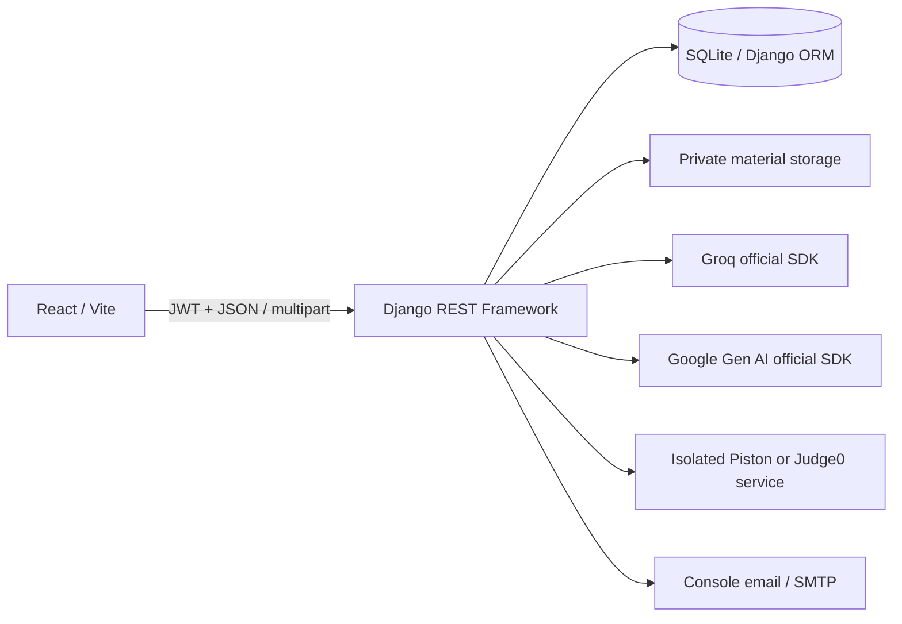
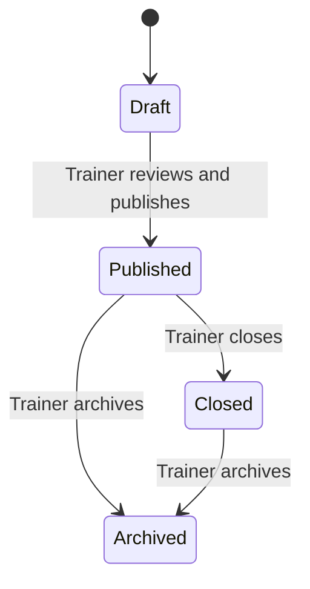

# Architecture

## Components

The repository root contains `backend` and `frontend`. Django apps follow domain boundaries: accounts, courses, materials, assignments, submissions, reports, and core. AI, analytics, and execution modules expose service functions independent of HTTP views. This makes moving work into background tasks possible without moving grading or access decisions into the frontend.

`core` contains shared permissions, error handling, audit records, notifications, configuration, and AI usage logs. Questions and test cases belong to the assignment app; evaluation audit records belong to submissions. User profiles are part of the custom user model. Extracted content and its approved analysis are stored on the material record. These are deliberate consolidations of the suggested model list.

## Trust boundaries

- Authentication uses short-lived access tokens held in memory and rotating refresh tokens stored in the browser tab's session storage. Logout blacklists the refresh token and clears cached assessment answers. Access tokens already issued remain valid until their short expiry unless the account is deactivated or its password changes. Production deployments that require immediate token revocation should add an access-token revocation/version check.
- A trainer owns students, courses, materials, assessments and reports. Querysets constrain every object lookup to the authenticated role and owner. Students use `AssignmentAccess` foreign keys, never a submitted email address, to authorize assessments.
- Students cannot self-register, set their own role, change their account email, or edit marks. Trainers can grant immediate access without email: the server generates a password, stores only its hash, and returns it once to the owning trainer with a no-store response. The email identifies the account; the password authenticates it. Profile updates expose only name and biography; a separate password change endpoint requires the current password.
- The application never returns question answer keys to students. Public question serializers expose only the prompt, options, and sample tests. Hidden test cases are restricted to trainer views and backend evaluation.
- Correct-answer explanations and marks are unavailable before result release. Trainer-only report observations are removed from student JSON and PDFs.
- Uploaded filenames are replaced with UUID storage names. Extension, file signature/container, size, decompressed archive size, extracted length, encryption, and empty-text checks precede processing. Scanned PDFs report an OCR requirement. The application does not perform OCR. Python source uploads preserve whitespace and are never executed. Jupyter format-v4 notebooks are structurally validated and contribute only ordered cell sources, excluding outputs, attachments, and metadata from AI input.
- Student source goes only to the selected isolated Piston or Judge0 runner. There is no `exec`, `eval`, local subprocess runner, or local code-execution fallback. Network restrictions must also be enforced by the executor host. Self-hosted Piston requires a dedicated Linux VM/host; its privileged container must not share the application host or its secrets. Piston's bounded response is validated before any marks are calculated; missing, internal, or malformed results preserve retryable attempts.
- Provider keys exist only in backend environment variables. SDK requests send bounded educational content or minimized learning evidence, not student names/emails/passwords. AI usage records do not retain prompts or outputs.

## Assessment lifecycle

Publication validates every question and its answer/test structure. Published content is immutable. Assigning a published assessment creates identity-based access records and notifications. Starting an attempt takes a lock on the access record and consumes an attempt number. Existing unfinished attempts are resumed, not duplicated.

The server computes `expires_at` as the earlier of the assessment deadline and attempt start plus duration. Answer-saving requires an active, open attempt. After time expires, students can submit only answers already saved on the server. This avoids trusting a browser timer or accepting late edits. Finalization uses a conditional status transition to prevent duplicate grading. The request persists all evaluation outcomes atomically, then recalculates marks from fresh database rows.

Objective answers are deterministic. Coding scores come from weighted test passes. Written/practical/project answers require trainer review. AI can suggest qualitative rubric feedback; it cannot mutate official scores. Marks are released explicitly after assessment closure/deadline and completion of pending reviews.

## Report integrity

Django computes scores, completion, topic averages, coding accuracy, attempts and trends. Gemini receives a bounded evidence snapshot, available topics, and assignments already accessible to the student. A Pydantic schema rejects malformed output; references to unknown submissions/topics/assignments are rejected. Numeric claims in report prose are discouraged and checked, while all displayed numeric cards use the database snapshot. Qualitative AI interpretation still requires human review; schema validation does not prove pedagogical correctness.

Reports are drafts until a trainer publishes them. Reports retain their evidence snapshot and creation time. Regeneration creates a new historical record. The learning-path endpoint checks publication, per-report and platform settings, and current access to each linked assessment. Revoked or archived assignments do not become links simply because an old report mentioned them.

## Performance and scope

Pagination limits collection endpoints to twenty records by default, at most one hundred per page. This implementation prioritizes correctness and small-class usability. Analytics aggregation is synchronous and intentionally readable; larger datasets need pre-aggregation and query optimization. AI generation and grading service functions can become Celery tasks later. The environment's SQLite and process-local cache are not substitutes for PostgreSQL and a shared throttle cache at scale.

Gamification derives points from the best verified, released result per student/assessment. Repeated submissions cannot inflate points or duplicate badge claims. Weekly rankings use a rolling seven-day window. Public leaderboard entries contain names and aggregate points/badges, never email addresses or private reports. Visibility is off until a trainer enables it.
